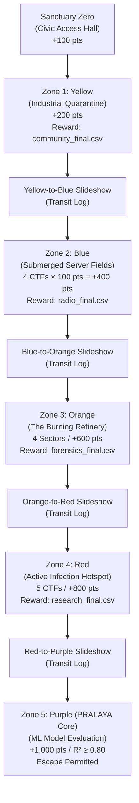

# THE LAST DATASET — CANONICAL GAME CONTRACT
**Version:** 1.0.0-PROD  
**Authoritative Standard:** TechTatva 2026 | MAHE Manipal  
**Total Competition Points:** Exactly 3,100 points  

---

## 1. Canonical Zone Sequence & Progression Graph

Progression is strictly sequential and immutable. A team cannot enter or score in Zone $N+1$ until Zone $N$ has been authoritatively marked complete in the central database ledger.



---

## 2. Canonical Score Allocation (Strict 3,100 Points)

| Zone ID | Order | Sector Name | Points | Prerequisite | Reward Dataset | Deployed Target URL | Authoritative Adjudication |
|---|---|---|---|---|---|---|---|
| `sanctuary` | 0 | Sanctuary Zero | **100** | None | None | `https://last-dataset-sanc.vercel.app/` | Gate Flag check (`community-gate`) |
| `yellow` | 1 | Industrial Quarantine | **200** | `sanctuary` | `community_final.csv` | `https://yellow-zone-neon.vercel.app/` | `FLAG{CONTINUITY_841_0217_UNIT404}` via `/api/yellow/complete` |
| `blue` | 2 | Submerged Server Fields | **400** | `yellow` | `radio_final.csv` | `https://bluezone-xi.vercel.app/blue-zone` | 4 CTFs × 100 pts (`blue-zone-ctf-01` to `04`) |
| `orange` | 3 | The Burning Refinery | **600** | `blue` | `forensics_final.csv` | `https://or-light-gamma.vercel.app/` | 4 Forensic Sectors via `/api/orange/complete` |
| `red` | 4 | Active Infection Hotspot | **800** | `orange` | `research_final.csv` | `https://red-five-liart.vercel.app/` | 5 CTFs (`red-01` to `red-05`) via `/api/red/complete` |
| `purple` | 5 | PRALAYA Core / ML Evaluator | **1,000** | `red` | None (Final Escape) | `https://last-dataset.vercel.app/purple` | 120 survivor predictions, $R^2 \ge 0.80$ |
| **TOTAL** | | | **3,100** | | | | |

---

## 3. Challenge Specifications & Verification Requirements

### Zone 0: Sanctuary Zero (`sanctuary`) — 100 Points
- **Challenge ID:** `sanctuary-gate`
- **Objective:** Verify identity records, trigger evacuation countdown, and authorize gate departure.
- **Verification:** POST `/api/ctf/community-gate` verifies flag against server environment secret.
- **Completion Hook:** Central Hub `/api/integrations/sanctuary-complete` records completion and awards 100 points.

### Zone 1: Yellow Zone (`yellow`) — 200 Points
- **Challenge ID:** `yellow-01`
- **Objective:** Reconstruct community registry across Hospital, School, Museum, Sports, and Society.
- **Canonical Flag:** `FLAG{CONTINUITY_841_0217_UNIT404}`
- **Verification:** Server-side adjudication on Central Hub (`/api/yellow/complete` or signed `/api/integrations/zone-ctf-complete`).
- **Reward:** Unlocks `community_final.csv` and Blue Zone prerequisite.

### Zone 2: Blue Zone (`blue`) — 400 Points (4 × 100 Points)
- **Challenge IDs:**
  1. `blue-zone-ctf-01`: Packet correlation (`BLUEZONE{BLACKOUT-17}`) — 100 pts
  2. `blue-zone-ctf-02`: Relay decryption (`BLUEZONE{SILENT_RELAY}`) — 100 pts
  3. `blue-zone-ctf-03`: Audio recovery (`BLUEZONE{NORTHLIGHT}`) — 100 pts
  4. `blue-zone-ctf-04`: Carrier navigation (`BLUEZONE{KAPU_LIGHTHOUSE}`) — 100 pts
- **Emergency Broadcast Console:** Submits final keyword `BLUEZONE`.
- **Verification:** POST `/api/ctf/verify` in `bluezone` evaluates flag against `CANONICAL_FLAGS` and submits HMAC-signed solve to Hub `/api/internal/complete`.
- **Reward:** Unlocks `radio_final.csv` and Orange Zone prerequisite.

### Zone 3: Orange Zone (`orange`) — 600 Points
- **Challenge Architecture:** 4 Forensic Sectors in `or_light`:
  1. Sector 1 (`building-1`): eMMC File Carving (`MANU{w1p3d_t3rm1n4l_c4rv3d_031440}`)
  2. Sector 2 (`building-2`): Metadata Provenance (`MANU{ROHAN_0335}`)
  3. Sector 3 (`building-3`): Vigenère Cryptanalysis (`MANU{AGE_SLEEP_SKILL_STRESS_FOCUS}`)
  4. Sector 4 (`building-4`): Package Integrity (`MANU{ration_audit.csv_7dfdbe62}`)
- **Resolution of Central Discrepancy:** The 4 sectors are verified locally on `or_light` server (`/api/verify-flag`). When all 4 fragments are assembled, the finale triggers `/api/orange-zone/complete` $\rightarrow$ Central Hub `/api/orange/complete` awarding 600 points atomically.
- **Reward:** Unlocks `forensics_final.csv` and Red Zone prerequisite.

### Zone 4: Red Zone (`red`) — 800 Points
- **Challenge Architecture:** 5 Progressive CTFs in `red`:
  1. CTF 1 (`red-01`): GHOST SIGNAL (`RZ{ad88a47811ca5d67b4e14f8b299ef3f6a979660e}`)
  2. CTF 2 (`red-02`): SANCTUARY ARCHIVE (`RZ{94526fd2e1c39c4b62ec830c0be08f41}`)
  3. CTF 3 (`red-03`): CHILD DATASET (`RZ{34f853312874e6d988c9ab7ede630eee}`)
  4. CTF 4 (`red-04`): CENTRAL ATRIUM (`RZ{blackout_protocol_quiesce}`)
  5. CTF 5 (`red-05`): BIOARCHIVE (`RZ{split_seal_final_7d3a91c2}`)
- **Resolution of Central Discrepancy:** Each CTF verifies against `CANONICAL_RED_HASHES` via `/api/ctf/verify`. Solving CTF 5 triggers the Red Zone finale, unlocking `/api/red/complete` on Central Hub and awarding 800 points.
- **Reward:** Unlocks `research_final.csv` and Purple Zone prerequisite.

### Zone 5: Purple Zone (`purple`) — 1,000 Points
- **Challenge ID:** `purple-01`
- **Objective:** Train regression model on merged datasets (`community_final`, `radio_final`, `forensics_final`, `research_final`) to predict survival probability for 120 test rows.
- **Submission Limits:** Exactly 10 atomic submissions per team.
- **Evaluation Criteria:**
  - Header: `Sanctuary_ID,Survival_Probability`
  - Exactly 120 unique valid IDs (`SANC-0001` to `SANC-0120`)
  - Probabilities bounded in $[0.0, 1.0]$
  - Qualification Threshold: $R^2 \ge 0.8000$ (80.00%)
- **Escape Condition:**
  - First qualifying submission locks escape eligibility permanently.
  - No further submissions allowed (`429 PURPLE_ALREADY_COMPLETED`).
  - Awards exactly 1,000 points atomically.
  - Final score reaches exactly 3,100 points.

---

## 4. Authentication, Launch Tokens & Session Contracts

### Launch Token Format
All cross-application handoffs originating from Central Hub generate an HMAC-SHA256 signed capability token:
$$\text{Token} = \text{base64url}(\text{Payload}) \,\|\, '.' \,\|\, \text{HMAC-SHA256}(\text{SESSION\_SECRET}, \text{"launch:"} \,\|\, \text{base64url}(\text{Payload}))$$

**Payload Schema:**
```json
{
  "teamId": "TEAM_ID",
  "delegateId": "OPERATOR",
  "zoneId": "blue",
  "iat": 1728900000000,
  "exp": 1728901800000
}
```
- **TTL:** Exactly 30 minutes from issuance.
- **Validation:** Recipient application verifies HMAC signature using shared `SESSION_SECRET`.
- **Fail-Closed:** Missing, expired, or tampered tokens are rejected with HTTP 401.

### Session Cookies
- Main Hub session: `tld_session_id` (cryptographically signed HTTP-only cookie).
- Blue Zone session: `bz_session` (signed capability cookie).

---

## 5. Central Completion API Specifications

### POST `/api/zone/complete` & `/api/[zone]/complete`
- **Headers:** `Cookie: session=...` or `Authorization: Bearer <SERVICE_TOKEN>`
- **Request Body:**
```json
{
  "teamId": "TEAM_ALPHA",
  "delegateId": "OPERATOR"
}
```
- **Success Response (200 OK):**
```json
{
  "ok": true,
  "zoneId": "orange",
  "teamId": "TEAM_ALPHA",
  "score": 1300,
  "bootstrap": { ... }
}
```
- **Failure Responses:**
  - `401 Unauthorized`: Missing or invalid session/service credentials.
  - `403 Forbidden`: `PREREQUISITE_NOT_MET` (previous zone incomplete) or `CHALLENGES_INCOMPLETE`.
  - `429 Too Many Requests`: Submission quota exceeded.

---

## 6. Idempotency & Concurrency Guarantees

1. **Atomic Ledger:** Every score update uses an immutable idempotency key:
   $$\text{Key} = \text{team\_id} \,\|\, ':' \,\|\, \text{zone\_id} \,\|\, [':' \,\|\, \text{challenge\_id}]$$
2. **Double-Spend Prevention:** Repeated submissions for already-cleared challenges return HTTP 200 with cached success status and award 0 additional points.
3. **Distributed Locks:** Central Hub serializes concurrent team operations using PostgreSQL `pg_advisory_xact_lock` or Redis REST compare-and-swap locks.
