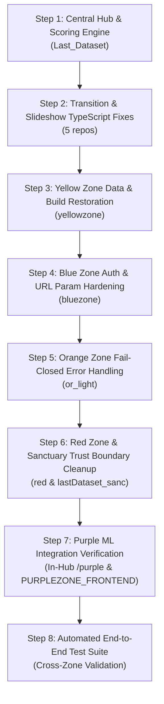

# THE LAST DATASET — REPAIR PLAN & EXECUTION SPECIFICATION
**Version:** 1.0.0-PROD  
**Strategy:** Minimal viable diffs, dependency order, zero downtime, isolated rollback capability.  

---

## 1. Repair Phasing & Dependency Sequence



---

## 2. Granular Task Breakdown by Dependency Tier

### Tier 1: Transition & Slideshow Repositories (Build Restorations)
**Target Repositories:**
1. `repos/yellow_to_blue_slideshow`
2. `repos/blue_orange_slideshow`
3. `repos/orange_to_red_slideshow`
4. `repos/red_purple_slideshow`
5. `repos/intro_stroyline`

- **Issue:** Next.js 15/16 PageProps typing failure: `searchParams?: Promise<{...}> | {...}` causes TypeScript compilation errors.
- **Root Cause:** Next.js 15/16 strictly expects `searchParams` to be a Promise satisfying `PageProps`. The union type is rejected by `.next/types`.
- **Patch:**
  ```tsx
  export default async function Page(props: {
    searchParams?: Promise<{ [key: string]: string | string[] | undefined }>;
  }) {
    const resolved = props.searchParams ? await props.searchParams : {};
    const team = (typeof resolved?.team === 'string' ? resolved.team : typeof resolved?.teamId === 'string' ? resolved.teamId : '').trim();
    ...
  }
  ```
- **Rollback Strategy:** Revert page component signatures via `git checkout -- app/`.

---

### Tier 2: Yellow Zone Build & Data Restoration
**Target Repository:** `repos/yellowzone`
- **Issue:** Missing data files `src/data/communityDataset.ts` and `src/data/investigationData.ts`, plus type mismatches on `SystemHeaderProps`.
- **Root Cause:** Refactored investigation components were merged into `yellowzone` without committing the data fixtures.
- **Patch:**
  1. Copy canonical `communityDataset.ts` and `investigationData.ts` from `yellow_zone` to `yellowzone/src/data/`.
  2. Fix `teamId` prop in `SystemHeaderProps` or pass properly.
  3. Verify `npm run build` succeeds cleanly.
- **Rollback Strategy:** `git checkout cb6fe6e` and clean untracked data files.

---

### Tier 3: Blue Zone Query Propagation & Auth Guarding
**Target Repository:** `repos/bluezone`
- **Issue:**
  1. Redirect from `/` to `/blue-zone` drops search query parameters.
  2. `app/api/blue-zone/complete/route.ts` lacks fallback session resolution.
  3. `features/blue-zone/server/auth.ts` accepts raw unauthenticated `x-team-id`.
- **Patch:**
  1. Preserve `app/page.tsx` searchParams forwarding fix.
  2. Commit `getServerSession` enhancement in `complete/route.ts`.
  3. Enforce valid launch token validation when in production mode.
- **Rollback Strategy:** `git checkout 23ed81f`.

---

### Tier 4: Orange Zone Fail-Closed Completion
**Target Repository:** `repos/or_light`
- **Issue:** `app/api/orange-zone/complete/route.ts` returns `{ ok: true }` even when Central Hub returns an error or is unreachable.
- **Patch:** Check `response.ok` from Central Hub. If false, return HTTP 502 with Central Hub error message to prevent client false positives.
- **Rollback Strategy:** `git checkout f80b62b`.

---

### Tier 5: Central Hub & Trust Boundary Hardening
**Target Repository:** Root (`Last_Dataset`)
- **Issue:**
  1. `config/zones.json` and `public/app.js` uncommitted edits for `/blue-zone`.
  2. Discrepancy between single CTF in config vs actual multi-sector implementations.
  3. Ensure `/api/integrations/zone-ctf-complete` and `/api/internal/complete` require valid HMAC/auth.
- **Patch:**
  1. Keep Blue Zone direct route `/blue-zone` to prevent redirect hops.
  2. Document Orange and Red multi-sector resolution in `CANONICAL_GAME_CONTRACT.md`.
  3. Maintain fail-closed checks on all zone completion endpoints.
- **Rollback Strategy:** `git checkout main`.

---

### Tier 6: Automated End-to-End Validation
- **Action:**
  1. Execute unit and security test suites: `npm test`.
  2. Run multi-team concurrency simulation (up to realistic load).
  3. Validate sequential unlocking (Sanctuary $\rightarrow$ Yellow $\rightarrow$ Blue $\rightarrow$ Orange $\rightarrow$ Red $\rightarrow$ Purple).
  4. Verify permanent escape lock upon qualifying ML submission ($R^2 \ge 0.80$).
